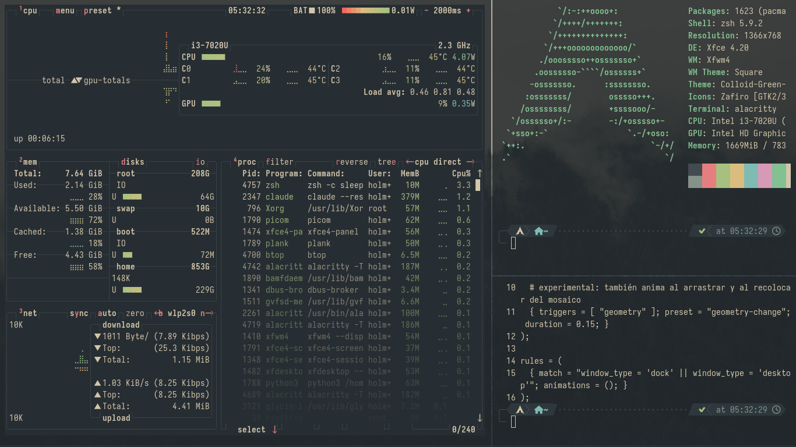

# dotfiles

Arch + XFCE (X11) con Everforest Dark Hard, bordes cuadrados y temas intercambiables.





## Uso

```sh
./install.sh            # máquina nueva: paquetes, temas, configs, ajustes XFCE
./install.sh --no-pkgs  # sin pacman/yay
./install.sh --capture  # al revés: trae al repo lo que cambiaste en el equipo (luego git status)
theme gruvbox           # cambiar de tema (en vivo)
theme everforest --system   # además el login (LightDM, pide sudo): drop-in en /etc/xdg/lightdm/lightdm-gtk-greeter.conf.d, assets en /usr/local/share
```

## Sistema (`system/`)

- `arch-base`: ajustes para cualquier PC con Arch + XFCE (zram, sysctl de memoria, THP, tope de `/tmp`, journald y coredumps con límite, LLMNR/mDNS fuera, sudoers, GRUB y LightDM por drop-ins, Xorg apartado del OOM).
- `inspdell-system`: lo del Dell Inspiron 3481 encima de `arch-base` (WiFi/Ethernet, mitigación de CPU, GRUB con Pond, TLP, pantalla 2K). En otro PC no se instala.
- Se construyen con `makepkg -f` en su carpeta y se instalan con `sudo pacman -U`; `pacman -R` los deshace. `system/bench` mide el equipo (`~/inspdell-logs/bench-<nombre>.txt`).

## Cómo está hecho

- `home/` es un espejo de `~`. `install.sh` copia cada fichero (lo que ya existía distinto queda como `*.pre-dotfiles`), y los temas a `~/.local/share/dotfiles/themes`. Nada apunta al repo: se puede mover o borrar. Se edita en `~` y `--capture` lo trae de vuelta; `install.sh` pisa lo que no se haya capturado.
- `~/.config/theme` es un enlace a `~/.local/share/dotfiles/themes/<nombre>`. Alacritty, Rofi, p10k y Legcord importan sus colores desde ahí, así que sus configs no cambian nunca.
- `bin/theme` aplica el resto:
  - por xfconf: GTK, iconos, cursor y fondo;
  - por gsettings: libadwaita y Electron;
  - con un `sed` de una línea: btop, VS Code y Zed (no se enlazan porque reescriben su propia config);
  - además Plank y Spicetify.
- fzf, bat, micro, cava, htop, git y ls usan los 16 colores ANSI de la terminal: siguen al tema sin fichero propio.
- Tema GTK: [Colloid](https://github.com/vinceliuice/Colloid-gtk-theme) con `--tweaks normal` (botones `_ □ x` en círculo gris, no los puntos de colores tipo Mac); `install.sh` pone a 0 todo radio no circular en el CSS compilado.
- Iconos: Zafiro (variante de Archcraft) arreglado, sin enlaces rotos y heredando solo temas que existen. Va en `extras/icons/Zafiro.tar.zst`.
- Bordes de ventana: tema xfwm4 `Square`, generado con `extras/make-xfwm4-square.py`: barra oscura de 22px (`TITLE`), esquinas rectas y contorno oscuro de 1px del Default de xfwm4 (colores del tema GTK), con los botones redondos del Everforest-GTK-Theme de Fausto (PNG sin fondo, valen para cualquier tema).
- Alacritty: fondo un tono más oscuro que el de las ventanas (bg_dim / hard) y selección gris.
- Panel: iconos monocromos (bandeja en modo simbólico y los `-symbolic` de `home/.local/share/icons/hicolor`, más `window > image` en gtk.css para los de bandeja antiguos como Clipman). Para cualquier otra app de bandeja, `extras/icons/tray-symbolic.tar.zst`: ~7000 `-symbolic` sacados de los iconos de panel de Everforest-Dark (`extras/make-tray-symbolic.py`; si una app nueva sale en color, añadir su nombre a `ALIASES`). Las que mandan imagen (Electron) se configuran en la app: Legcord usa `dsc-tray`. CPU, RAM y WiFi con genmon + `panel-stats` (solo builtins de bash, cada 2 s).
- Apps Qt: `QT_QPA_PLATFORMTHEME=gtk3` en `.xprofile`, sin Kvantum. Hace falta volver a iniciar sesión.
- Compositor: picom (`home/.config/picom/picom.conf`, arranca con `home/.config/autostart/picom.desktop`) en lugar del de xfwm4, que `install.sh` apaga. Sin sombras ni esquinas redondas; anima abrir/cerrar (escala + fundido) y mover/redimensionar (experimental: también al arrastrar y al recolocar del mosaico). Cuesta ~4 % más de un núcleo que xfwm4 con ventanas en movimiento; GPU igual.

## Mosaico (tiling)

`home/.local/bin/tiling`: mosaico propio sobre xfwm4 (Python + Wnck, sin dependencias nuevas). Apagado al iniciar; **Super+T** lo enciende o apaga en el escritorio actual. `tiling -h` recuerda todos los atajos.

- Espiral áurea: cada ventana nueva se queda con el 61,8 % del hueco libre, girando derecha → abajo → izquierda → arriba. Sin límite de ventanas.
- Redimensionar una ventana mueve el corte que comparte con sus vecinas: si una crece, las de al lado encogen. Con el teclado o con el ratón (Alt + arrastrar con el botón derecho; las vecinas se ajustan al soltar). Mover una ventana con el ratón (Alt + arrastrar) y soltarla encima de otra las intercambia; soltarla en otro sitio la devuelve a su hueco.
- Encendido, las ventanas van sin barra de título y separadas por 2px (`GAP`): xfwm4 no sabe dibujar el borde sin la barra.
- Fuera del mosaico: diálogos, ventanas fijadas en todos los escritorios, pantalla completa y las que maximizas. Al encender se desmaximizan todas una vez.
- El estado (escritorios en mosaico y ventanas sin barra) se guarda en `$XDG_RUNTIME_DIR/tiling.json`: reiniciar el daemon no lo pierde, cerrar sesión sí.
- `tiling daemon` (lo lanza el primer atajo, no ocupa memoria hasta entonces) coloca las ventanas; los atajos le mandan órdenes por un FIFO en `$XDG_RUNTIME_DIR`. Los atajos son de XFCE, así que funcionan con Bloq Num.
- Solo usa el monitor principal.

| Atajo | Acción |
|---|---|
| Super+T | encender o apagar el mosaico en este escritorio |
| Super+Alt+H / J / K / L | foco a la izquierda, abajo, arriba o derecha |
| Super+Alt+Enter | la ventana activa pasa a ser la principal |
| Super+Alt+Shift+H / J / K / L | intercambiar la ventana activa con la vecina de la izquierda, abajo, arriba o derecha |
| Super+Alt+← → ↑ ↓ | mover 40px el borde de la ventana activa (primero el derecho o el inferior; si es el de la pantalla, el otro) |
| Alt + arrastrar con botón derecho | redimensionar con el ratón (xfwm4) |

Super+Alt+↑ era "maximizar" en xfwm4: ahora es de `tiling`, que fuera del mosaico sigue maximizando y restaurando (y dentro, con una ventana maximizada, la devuelve al mosaico).

## Añadir un tema

1. `cp -r themes/gruvbox themes/<nuevo>`.
2. Editar en esa carpeta:
   - `theme.env` (nombres de GTK, iconos, cursor, btop, VS Code, Zed y Spicetify);
   - `alacritty.toml`, `rofi.rasi`, `p10k.zsh`, `plank/dock.theme` y `legcord.css` (colores);
   - los fondos, en `walls/` (`WALLS` en `theme.env`: uno por escritorio; `LOGIN_WALL` para el login).
3. Si Colloid tiene ese esquema (nord, dracula, catppuccin), compilarlo como en `install.sh`.

`theme` valida que existan el GTK, los iconos y el cursor antes de tocar nada.

## Manual (no se puede automatizar bien)

| App | Tema |
|---|---|
| Zen | [Everforest Dark Official](https://addons.mozilla.org/firefox/addon/everforest-dark-official/) (de sainnhe) |
| Brave | un tema Everforest de la Chrome Web Store |
| Obsidian | Ajustes → Apariencia → Temas → "Everforest Enchanted" |
| Zed | extensión "Everforest" (`zed: extensions`); Gruvbox ya viene incluido |
| Spotify | `sudo chmod a+wr /opt/spotify && sudo chmod -R a+wr /opt/spotify/Apps`, luego `spicetify backup apply` |
| Legcord | reiniciarlo para que cargue `quickCss.css` |
