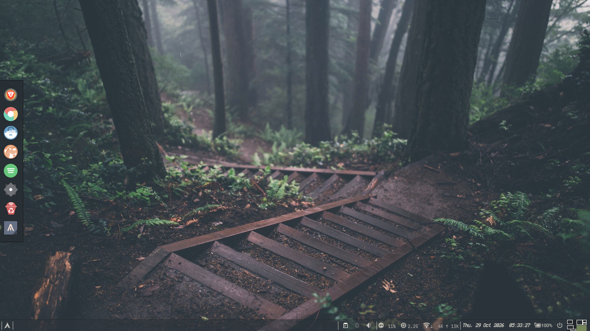
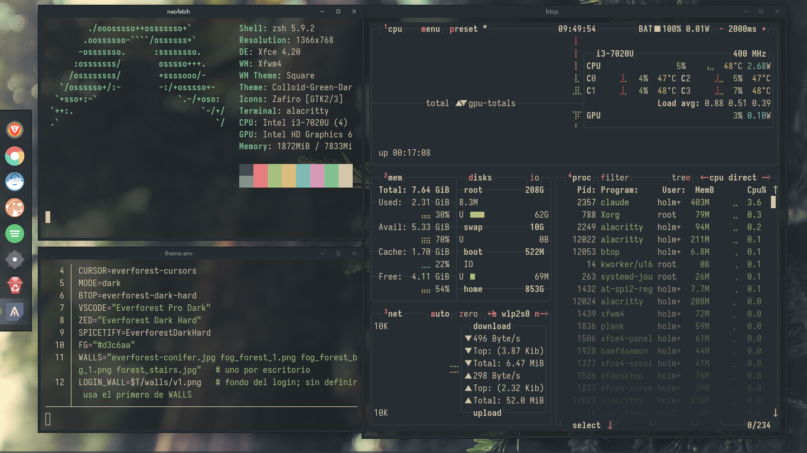
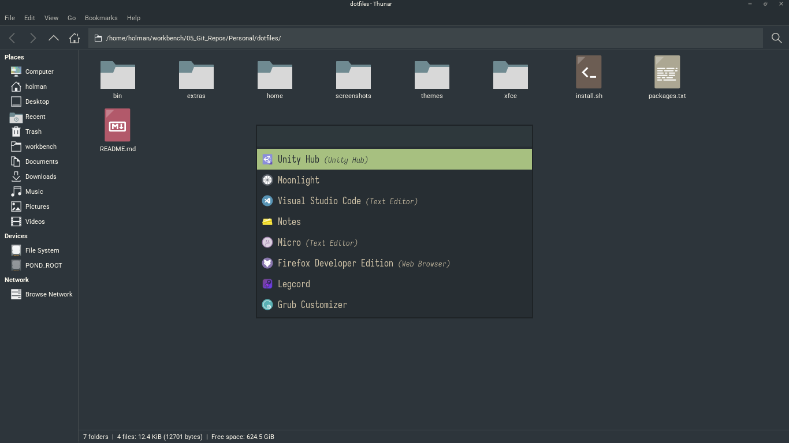

# dotfiles

Arch + XFCE (X11) con Everforest Dark Hard, bordes cuadrados y temas intercambiables.







## Uso

```sh
./install.sh            # máquina nueva: paquetes, temas, enlaces, ajustes XFCE
./install.sh --no-pkgs  # sin pacman/yay
theme gruvbox           # cambiar de tema (en vivo)
theme everforest --system   # además el login (LightDM, pide sudo)
```

## Cómo está hecho

- `home/` es un espejo de `~`. `install.sh` enlaza cada fichero; lo que ya existía queda como `*.pre-dotfiles`.
- `~/.config/theme` es un enlace a `themes/<nombre>`. Alacritty, Rofi, p10k y Legcord importan sus colores desde ahí, así que sus configs no cambian nunca.
- `bin/theme` aplica el resto:
  - por xfconf: GTK, iconos, cursor y fondo;
  - por gsettings: libadwaita y Electron;
  - con un `sed` de una línea: btop, VS Code y Zed (no se enlazan porque reescriben su propia config);
  - además Plank y Spicetify.
- fzf, bat, micro, cava, htop, git y ls usan los 16 colores ANSI de la terminal: siguen al tema sin fichero propio.
- Tema GTK: [Colloid](https://github.com/vinceliuice/Colloid-gtk-theme) con `--tweaks normal` (botones `_ □ x` en círculo gris, no los puntos de colores tipo Mac); `install.sh` pone a 0 todo radio no circular en el CSS compilado.
- Iconos: Zafiro (variante de Archcraft) arreglado, sin enlaces rotos y heredando solo temas que existen. Va en `extras/icons/Zafiro.tar.zst`.
- Bordes de ventana: tema xfwm4 `Square`, generado con `extras/make-xfwm4-square.py`: barra oscura de 22px (`TITLE`), esquinas rectas y contorno oscuro de 1px del Default de xfwm4 (colores del tema GTK), con los botones redondos del Everforest-GTK-Theme de Fausto (PNG sin fondo, valen para cualquier tema).
- Alacritty: fondo un tono más oscuro que el de las ventanas (bg_dim / hard) y selección gris.
- Panel: iconos monocromos (bandeja en modo simbólico y los `-symbolic` de `home/.local/share/icons/hicolor`, más `window > image` en gtk.css para los de bandeja antiguos como Clipman). Para cualquier otra app de bandeja, `extras/icons/tray-symbolic.tar.zst`: ~7000 `-symbolic` sacados de los iconos de panel de Everforest-Dark (`extras/make-tray-symbolic.py`; si una app nueva sale en color, añadir su nombre a `ALIASES`). Las que mandan imagen (Electron) se configuran en la app: Legcord usa `dsc-tray`. CPU, RAM y WiFi con genmon + `panel-stats` (solo builtins de bash, cada 2 s).
- Apps Qt: `QT_QPA_PLATFORMTHEME=gtk3` en `.xprofile`, sin Kvantum. Hace falta volver a iniciar sesión.

## Mosaico (tiling)

[xpytile](https://github.com/jaywilkas/xpytile) encima de xfwm4, apagado al iniciar. **Super+T** lo enciende o apaga en el escritorio actual; encendido, las ventanas van sin barra de título.

- `home/.local/bin/tiling`: el switch. Con `daemon` (lo lanza `home/.config/autostart/tiling.desktop`) arranca xpytile con el mosaico apagado en todos los escritorios: xpytile no tiene opción para eso y se parchea al cargarlo.
- `home/.config/xpytilerc`: copia de `/etc/xpytilerc` con los atajos movidos a Super+Alt, porque los de Super solo los usan XFCE y xfwm4.

| Super+Alt + | Acción |
|---|---|
| H J K L | foco a la izquierda, abajo, arriba o derecha |
| B | foco a la ventana anterior |
| Enter | cambiar la activa con la principal |
| , . | encoger o agrandar la principal |
| 1 2 3 4 0 | maestro+pila vertical, vertical, maestro+pila horizontal, horizontal, maximizar |
| C | siguiente distribución |
| Tab | rotar ventanas |
| M N | más o menos ventanas en el mosaico (3 por defecto) |

## Añadir un tema

1. `cp -r themes/gruvbox themes/<nuevo>`.
2. Editar en esa carpeta:
   - `theme.env` (nombres de GTK, iconos, cursor, btop, VS Code, Zed y Spicetify);
   - `alacritty.toml`, `rofi.rasi`, `p10k.zsh`, `plank/dock.theme` y `legcord.css` (colores);
   - los fondos, en `walls/` (`WALLS` en `theme.env`: uno por escritorio; `LOGIN_WALL` para el login).
3. Si Colloid tiene ese esquema (nord, dracula, catppuccin), compilarlo como en `install.sh`.

`theme` valida que existan el GTK, los iconos y el cursor antes de tocar nada.

## Manual (no se puede automatizar bien)

| App | Tema |
|---|---|
| Zen | [Everforest Dark Official](https://addons.mozilla.org/firefox/addon/everforest-dark-official/) (de sainnhe) |
| Brave | un tema Everforest de la Chrome Web Store |
| Obsidian | Ajustes → Apariencia → Temas → "Everforest Enchanted" |
| Zed | extensión "Everforest" (`zed: extensions`); Gruvbox ya viene incluido |
| Spotify | `sudo chmod a+wr /opt/spotify && sudo chmod -R a+wr /opt/spotify/Apps`, luego `spicetify backup apply` |
| Legcord | reiniciarlo para que cargue `quickCss.css` |

## No incluido

- GRUB: se queda el tema Hollow Knight.
- xfce4-terminal: la terminal por defecto es Alacritty.
- Configs huérfanas (hypr, waybar, wofi, mako, swaylock, starship): no se tocan.
